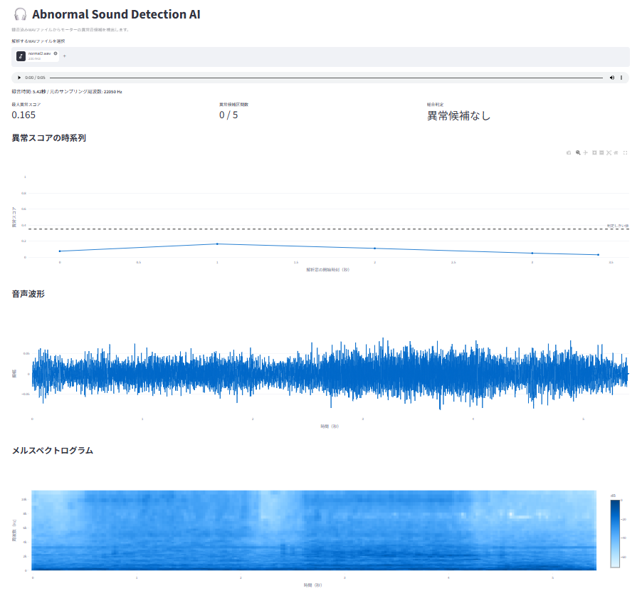

# Abnormal Sound Detection AI (異常音検知AI) 🎧

機械学習（Random Forest）と音声信号処理（Librosa）を活用した、モーター等の機器・設備の異常音検知Webアプリケーションシステムです。

録音されたWAVファイルから複数の音声特徴量を抽出し、時系列ごとに異常スコアの可視化および異常箇所の検出を行います。

## 🌟 主な機能

* **特徴量抽出 (`features.py`)**
  * メル周波数ケプストラム係数 (MFCC)、スペクトル重心、ゼロ交差率、RMS、スペクトル帯域幅、ロールオフ、フラットネス、オンセット強度を抽出
  * フレームごとの平均値と標準偏差を算出して特徴量ベクトル化

* **モデル学習・評価 (`train_cv.py`)**
  * フォルダ構造から「正常音」「異常音」データを自動読み込み
  * ファイル（録音データ）単位のデータリークを防ぐ **Stratified Group K-Fold 交差検証** を採用
  * 混同行列、適合率 (Precision)、再現率 (Recall)、F1スコアなどの評価指標を出力し、モデル (`model.joblib`) を保存

* **Web UIダッシュボード (`app.py`)**
  * Streamlitを用いた直感的な操作画面
  * しきい値（Threshold）の動的調整機能
  * 音声波形およびメルスペクトログラムの可視化
  * 異常スコアの時系列グラフ表示と異常区間の自動判定
  * 判定結果のCSVダウンロード機能

## 📂 フォルダ構成

プロジェクト実行前に、以下のようにディレクトリおよびファイルを配置してください。

```
.
├── data/
│   ├── normal/     # 正常音のWAVファイル（2秒以上）を格納
│   └── abnormal/   # 異常音のWAVファイル（2秒以上）を格納
├── features.py     # 音声処理・特徴量抽出モジュール
├── train_cv.py     # 機械学習モデルの学習および評価スクリプト
├── app.py          # StreamlitベースのWebアプリケーション
├── requirements.txt # 必要ライブラリ一覧
├── model.joblib    # 学習済みモデル（train_cv.py実行後に自動生成）
└── README.md
```

## ⚙️ 動作環境・セットアップ

Python 3.9 以上での動作を想定しています。

### 1. `requirements.txt` の作成
プロジェクトのルートディレクトリに `requirements.txt` を作成し、以下を記述してください。

```text
numpy
pandas
scikit-learn
librosa
soundfile
joblib
streamlit
plotly
```

### 2. ライブラリのインストール

以下のコマンドを実行して必要なパッケージを一括でインストールします。

```bash
pip install -r requirements.txt
```

## 🚀 使い方

### 1. 学習データの準備

`data/normal/` フォルダと `data/abnormal/` フォルダに、それぞれのWAVファイルを格納します。

> **注意:** 2秒未満の音声ファイルは処理対象外としてスキップされます。各フォルダにそれぞれ **2ファイル以上のWAVファイル** が必要です。

### 2. モデルの学習 (`train_cv.py`)

以下のコマンドを実行してモデルを学習させます。

```bash
python train_cv.py
```

実行すると以下の処理が行われ、最終的に `model.joblib` が生成されます。

1. `data/normal/` および `data/abnormal/` からWAVデータを読み込み、2秒単位（1秒スライド）でセグメント化
2. 学習データ・評価データのファイル単位分割（Stratified Holdout）
3. 学習データ内での `StratifiedGroupKFold` 交差検証
4. ホールドアウト評価（設定された閾値での混同行列・レポート表示）
5. `model.joblib` へのモデルおよびパラメータの保存

### 3. Web UIの起動 (`app.py`)

モデルの学習完了後、Streamlitアプリを起動します。

```bash
streamlit run app.py
```

ブラウザでアプリが開いたら、以下の手順で解析を行います。

1. サイドバーで **異常判定しきい値** を調整（デフォルト: 0.35）
2. 解析したいWAVファイルをアップロード
3. 時系列の異常スコア、音声波形、メルスペクトログラム、および異常検出された区間を確認
4. 画面下のボタンから判定結果（CSV）をダウンロード

## 📷 Screenshots



## 📝 モデル仕様

| 項目 | 設定値 / 詳細 |
| ----- | ----- |
| **サンプリングレート (`SR`)** | 22,050 Hz |
| **分析ウィンドウサイズ (`DURATION`)** | 2.0 秒 |
| **シフトサイズ (`HOP`)** | 1.0 秒 |
| **アルゴリズム** | Random Forest (`n_estimators=200`, `class_weight='balanced'`) |
| **判定閾値（デフォルト）** | 0.35 |

## ⚠️ 注意事項

* 本アプリが出力する「異常スコア」は故障確率そのものではありません。
* モーターの回転数、負荷、録音環境（マイク距離やマイク位置など）を一定に揃えた上で評価してください。